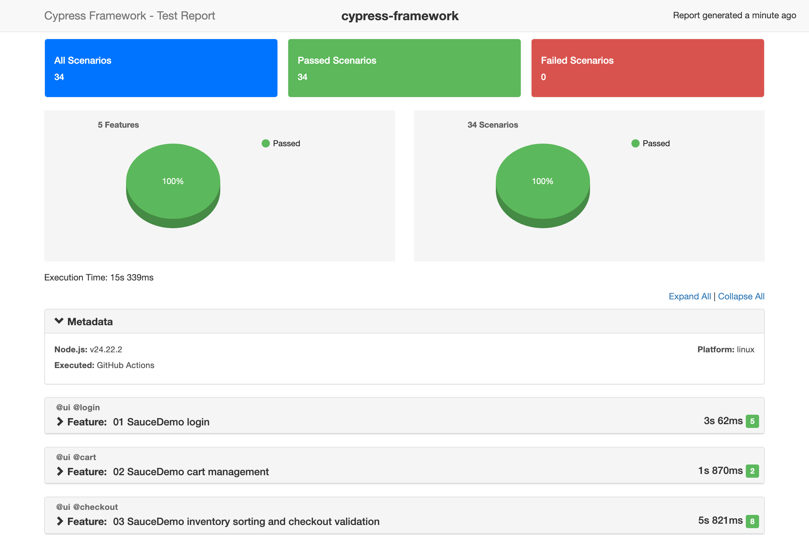

# Cypress Framework

[](https://github.com/nishajuss/cypress-framework/actions/workflows/ci.yml)


[](LICENSE)

A BDD test automation framework built with **Cypress**, **Cucumber** and **TypeScript**. It covers **UI**, **accessibility** and **REST API** testing against two public demo applications:

| Application | Type | Coverage |
| --- | --- | --- |
| [SauceDemo](https://www.saucedemo.com) | Web UI | Login, cart, inventory sorting, checkout validation, WCAG 2.2 AA accessibility |
| [Restful Booker](https://restful-booker.herokuapp.com/apidoc/index.html) | REST API | Token auth, booking create, read, search, replace, partial update and delete, authorisation, response contracts, known bugs |

📊 **[Latest test report](https://nishajuss.github.io/cypress-framework/)**: published from CI on every push to `main`.

> **See also:** [playwright-framework](https://github.com/nishajuss/playwright-framework), my Playwright and TypeScript framework with combined UI + API tests across Chromium, Firefox and WebKit.

[](https://nishajuss.github.io/cypress-framework/)

---

## Highlights

- **Behaviour-driven specs:** Gherkin feature files written in business language, with Scenario Outlines and data tables for data-driven coverage. BDD suits this app's short, clear user journeys: the scenarios read as plain-English acceptance criteria that testers, developers and product owners can all review. (My [Playwright framework](https://github.com/nishajuss/playwright-framework) deliberately doesn't use BDD, because its tests are aimed at engineers.)
- **Page Object Model:** one class per page plus shared components, using stable `data-test` selectors.
- **Fast, isolated UI tests:** login is cached with `cy.session()`, so scenarios that aren't testing login skip the UI login flow while each test still starts from a clean state.
- **Scenario-safe API state:** responses, bookings and tokens are stored in Cypress aliases instead of shared variables. A tagged `After` hook deletes every booking the tests create, so the shared public API is left clean even when a scenario fails.
- **Accessibility testing:** a typed `cy.checkAccessibility()` command injects axe-core into the page and audits it against WCAG 2.2 AA. Serious and critical violations fail the scenario; each violation is logged with the offending elements.
- **API contract validation:** response bodies are checked against strict [zod](https://zod.dev) schemas, which also generate the TypeScript types. An unexpected field, a wrong type or an invalid email fails the test with a readable, field-level error.
- **CI owns its API:** CI runs a private copy of the Restful Booker API in Docker (pinned by image digest), so the API scenarios never fail because a shared public server is down or blocking automated traffic. Local runs use the public site by default.
- **Known bugs are scenarios too:** each API defect the tests found has a `@known-bug` scenario that asserts today's behaviour and names the correct one. When a bug is fixed, its scenario fails with a message saying so, as a prompt to update it.
- **Parallel execution:** a custom TypeScript runner distributes feature files across a configurable pool of Cypress workers and merges the results into a single report.
- **Rich reporting:** an HTML Cucumber report with failure screenshots embedded against the failing step.
- **Quality gates:** strict TypeScript, ESLint (typescript-eslint, Cypress and JSON rules), gherkin-lint, and a Husky pre-commit hook running lint-staged.
- **CI/CD:** GitHub Actions runs static checks, then the full suite in Chrome and the UI scenarios in Firefox and Edge. It uploads artifacts, publishes the report to GitHub Pages, and runs weekly to catch drift in the applications under test. Dependabot keeps dependencies current.

## Bugs found

The API tests uncovered four defects in Restful Booker, each covered by a `@known-bug` scenario in [`04_BookingAPI.feature`](cypress/e2e/features/04_BookingAPI.feature):

| Request | Returns | Should return |
| --- | --- | --- |
| Log in with a wrong password | `200 OK` with `{"reason":"Bad credentials"}` | `401 Unauthorized` |
| Create a booking with missing fields | `500 Internal Server Error` | `400 Bad Request` |
| Delete a booking | `201 Created` | `200 OK` or `204 No Content` |
| Delete a booking that no longer exists | `405 Method Not Allowed` | `404 Not Found` |

## Tech stack

| Area | Tools |
| --- | --- |
| Test runner | Cypress 16 |
| BDD | `@badeball/cypress-cucumber-preprocessor`, esbuild |
| Accessibility | axe-core |
| API contracts | zod |
| Language | TypeScript (strict) on Node.js 24 |
| Reporting | `cucumber-html-reporter` |
| Code quality | ESLint 10 (flat config), typescript-eslint, `@stylistic`, gherkin-lint, Husky, lint-staged |
| CI | GitHub Actions, Docker (API service container), GitHub Pages, Dependabot |

## Project structure

```text
.
├── .github/
│   ├── workflows/ci.yml            # Lint → test (Chrome, Firefox, Edge) → publish report
│   └── dependabot.yml
├── cypress/
│   ├── api/
│   │   └── schemas.ts              # API response contracts (zod)
│   ├── e2e/
│   │   ├── features/               # Gherkin feature files (*.feature)
│   │   └── step_definitions/       # Step definitions grouped by domain
│   ├── fixtures/                   # Static test data
│   ├── pages/                      # Page objects
│   │   └── components/             # Shared UI components (e.g. header)
│   └── support/
│       ├── accessibility.ts        # cy.checkAccessibility (axe-core)
│       ├── commands.ts             # Typed custom commands (cy.loginAs, …)
│       └── e2e.ts
├── docs/images/                    # README assets
├── scripts/
│   ├── exportHTMLReport.ts         # Builds the HTML report and embeds screenshots
│   ├── loadEnv.ts                  # Env loading shared by Cypress and scripts
│   ├── runFeaturesInParallel.ts    # Feature-level parallel runner
│   └── writeJobSummary.ts          # Test results summary shown on each CI run page
├── cypress.config.ts
├── .env.template                   # Default (public) configuration values
└── package.json
```

## Getting started

**Prerequisites:** Node.js 24 (see `.nvmrc`), Yarn 1.x and Google Chrome. Docker is optional, for running the API locally.

```bash
nvm use
yarn install
cp .env.template .env   # optional: override any defaults locally
```

## Running tests

| Command | Description |
| --- | --- |
| `yarn cy:open` | Open the interactive Cypress runner |
| `yarn test` | Run the full suite headlessly in Chrome (or `BROWSER=firefox` / `edge`) and generate the HTML report |
| `yarn test:parallel` | Run feature files in parallel (`FEATURE_PARALLEL_WORKERS`, default `3`) |
| `yarn test:smoke` | Run only `@smoke` scenarios |
| `yarn test:ui` / `yarn test:api` | Run only UI or API scenarios |
| `yarn test:a11y` | Run only accessibility scenarios |
| `yarn booker:up` / `yarn booker:down` | Start or stop a local Restful Booker in Docker (then set `API_BASE_URL=http://localhost:3001`) |

You can run any [tag expression](https://cucumber.io/docs/cucumber/api/#tag-expressions) by setting `TAGS`:

```bash
TAGS="@checkout and not @ignore" yarn test
```

### Tags

| Tag | Meaning |
| --- | --- |
| `@ui` / `@api` | Test layer |
| `@login`, `@cart`, `@checkout`, `@a11y` | Functional area |
| `@smoke` | Critical-path subset for fast feedback |
| `@known-bug` | Documents a defect in the application under test |
| `@ignore` | Excluded from every run |

## Reports

After each run:

- **HTML report:** `report/HTML/cucumber_report.html`
- **Cucumber JSON:** `report/JSON/`

Failure screenshots are attached to the failing step in the HTML report. In CI, the report is uploaded as a build artifact and published to [GitHub Pages](https://nishajuss.github.io/cypress-framework/).

## Configuration

Values are resolved in this order, highest priority first:

1. Process environment (e.g. CI secrets)
2. `.env`: local overrides (git-ignored)
3. `.env.template`: committed defaults

The SauceDemo and Restful Booker credentials in `.env.template` are the public demo credentials each site publishes. `API_BASE_URL` chooses which Restful Booker the API scenarios use: the public site by default, or a local Docker copy.

## Code quality

```bash
yarn lint        # ESLint + gherkin-lint
yarn lint:fix    # Auto-fix ESLint issues
yarn typecheck   # TypeScript, strict mode
```

A pre-commit hook runs these checks against staged files.

## License

[MIT](LICENSE) © Nisha Juss
